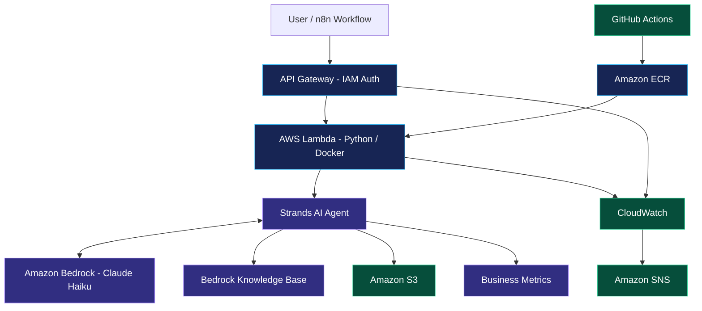
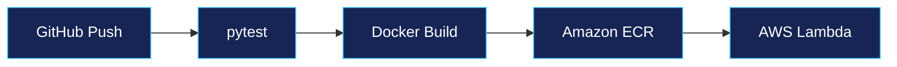

<div align="center">


### Intelligent Operations · Agentic Workflows · AWS Cloud

A serverless AI operations platform combining **Amazon Bedrock, Strands Agents, Retrieval-Augmented Generation, and n8n workflow automation**.

<br>


<br>


</div>

---

## Overview

**Enterprise Agentic AI Operations Platform** is a cloud-native backend system that connects large language models with operational tools, enterprise document retrieval, and business analytics.

Built with **Python and Strands Agents**, the platform uses Amazon Bedrock for model inference and AWS Lambda for serverless execution.

An IAM-protected API Gateway endpoint exposes the agent to external clients, including an n8n workflow that automates requests and processes agent responses.

The implementation covers agent orchestration, RAG, cloud integrations, containerized deployment, CI/CD, and operational monitoring.

---

## System Architecture



### Request Lifecycle

1. A client or n8n workflow submits an authenticated request to API Gateway.
2. API Gateway invokes the containerized AWS Lambda backend.
3. The Strands agent interprets the request and selects the appropriate tool.
4. The selected tool performs document retrieval, S3 inspection, or business calculations.
5. The agent processes the tool output and returns a natural-language response.

---

## Core Capabilities

<table>
<tr>
<td width="50%" valign="top">

### 🧠 Agent Orchestration

Natural-language request processing through Strands Agents and Amazon Bedrock.

- LLM-driven tool calling
- Task classification and planning
- Structured tool execution
- Response generation

</td>
<td width="50%" valign="top">

### 📚 Retrieval-Augmented Generation

Document-grounded responses using an existing Amazon Bedrock Knowledge Base.

- Knowledge Base retrieval
- Relevant evidence extraction
- Document summarization
- Source-aware answers

</td>
</tr>
<tr>
<td valign="top">

### 📊 Business Analytics

Dedicated calculation tools for financial and operational analysis.

- ROI calculation
- Net return analysis
- Input validation
- Explainable calculations

</td>
<td valign="top">

### ☁️ AWS Integration

Serverless operations with AWS-managed services.

- Amazon S3 document listing
- IAM-scoped resource access
- Lambda-based execution
- CloudWatch monitoring

</td>
</tr>
<tr>
<td valign="top">

### 🔄 n8n Automation

Workflow integration between n8n and the deployed AWS agent.

- Webhook-triggered workflows
- AWS IAM-authenticated requests
- JSON request and response handling
- External agent invocation

</td>
<td valign="top">

### 🚀 DevOps

Containerized deployment with automated delivery.

- Docker packaging
- GitHub Actions CI/CD
- Amazon ECR
- AWS OIDC authentication

</td>
</tr>
</table>

---

## Technology Stack

| Layer | Technology |
|---|---|
| Programming | Python |
| Agent Framework | Strands Agents |
| LLM | Claude Haiku 4.5 via Amazon Bedrock |
| RAG | Amazon Bedrock Knowledge Bases |
| Backend | AWS Lambda |
| API | Amazon API Gateway |
| Storage | Amazon S3 |
| Automation | n8n |
| Containerization | Docker |
| CI/CD | GitHub Actions |
| Container Registry | Amazon ECR |
| Authentication | AWS IAM / SigV4 |
| Monitoring | Amazon CloudWatch |
| Notifications | Amazon SNS |
| Testing | pytest |

---

## Agent Tools

The agent uses specialized tools to perform operations beyond text generation.

| Tool | Responsibility |
|---|---|
| `search_knowledge_base` | Retrieve relevant enterprise document evidence |
| `list_s3_documents` | Discover documents stored in Amazon S3 |
| `calculate_business_metrics` | Calculate ROI and related financial metrics |

### Example: Business Metrics

**Request**

```json
{
  "prompt": "Calculate ROI for an investment of $13.3M and total returns of $20M."
}
```

**Calculation**

```text
Investment       $13,300,000
Total Returns    $20,000,000
Net Benefit       $6,700,000

ROI                    50.38%
```

---

## Workflow Automation with n8n

n8n acts as an external orchestration layer, connecting workflow triggers to the deployed AI backend.


The integration uses AWS Signature Version 4 authentication to invoke the API Gateway endpoint without exposing it as a publicly callable unauthenticated API.

---

## CI/CD Architecture

The deployment pipeline automates application testing, container builds, image publishing, and Lambda updates.



### Deployment Approach

- GitHub Actions runs the automated workflow.
- AWS OIDC provides temporary deployment credentials.
- Docker packages the application and dependencies.
- Amazon ECR stores the container image.
- AWS Lambda runs the updated image.

This approach avoids storing long-lived AWS access keys in the GitHub deployment workflow.

---

## Security and Observability

The platform uses AWS-native security and monitoring components.

**Security**

- IAM-authorized API Gateway endpoint
- Dedicated Lambda execution role
- Resource-scoped S3 and Knowledge Base access
- Dedicated IAM permissions for n8n API invocation
- GitHub Actions authentication through OIDC

**Observability**

- CloudWatch application logs
- Lambda error monitoring
- API Gateway 5xx monitoring
- CloudWatch alarms
- SNS email notifications

---

## Engineering Notes

### Bedrock Knowledge Base SDK Compatibility

During container deployment, the Knowledge Base retrieval integration encountered an AWS SDK parameter validation error.

The managed Knowledge Base required `managedSearchConfiguration`, but the installed botocore service model did not recognize that parameter.

The issue was resolved by updating the boto3 and botocore dependencies and adding a Docker build-time compatibility check.

This ensured the deployed Lambda container supported the required Bedrock Agent Runtime request structure.

---

## Repository

The project is maintained in GitHub with automated deployment through GitHub Actions.

**Repository:** [enterprise-agentic-ai-platform](https://github.com/GopikrishnaAshok/enterprise-agentic-ai-platform)

---

<div align="center">

## About the Developer

### GopiKrishna

**Senior Software Engineer**

Backend Engineering · AWS Cloud · DevOps · Generative AI · Agentic AI

[](https://github.com/GopikrishnaAshok)

<br>


</div>
