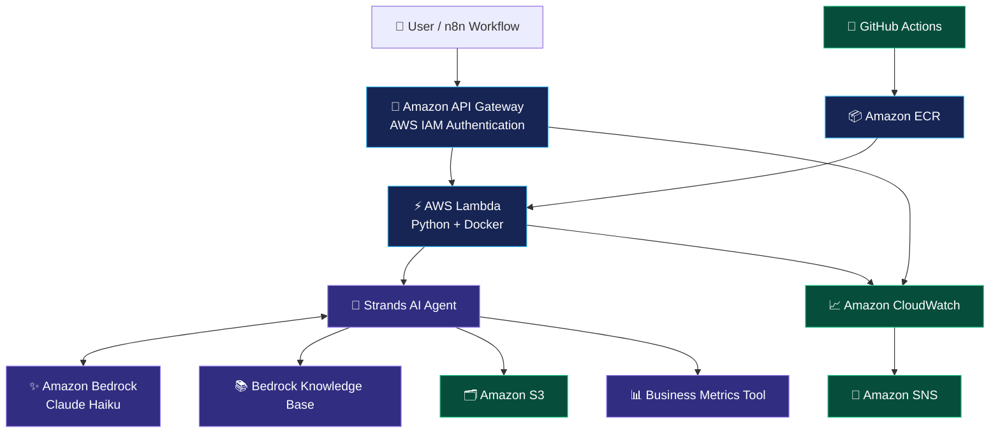
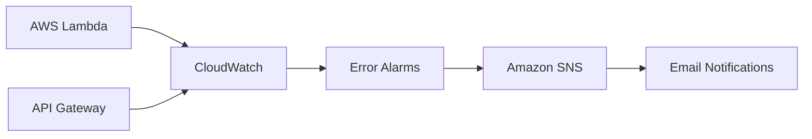

<div align="center">

# ⚡ ENTERPRISE AGENTIC AI
### Intelligent Operations · Autonomous Tool Calling · Cloud-Native Engineering

**A secure, serverless AI operations platform powered by Amazon Bedrock, Strands Agents, AWS Lambda, and n8n.**


<br/>


**[Architecture](#-system-architecture) • [Features](#-core-capabilities) • [Technology](#-technology-stack) • [Validation](#-verified-testing) • [Engineering](#-engineering-highlights)**

</div>

---

## 🌌 Overview

Enterprise Agentic AI is a cloud-hosted AI operations assistant designed to combine large language model reasoning with practical enterprise tools.

Rather than relying solely on generated answers, the agent can invoke dedicated tools to retrieve document evidence, inspect S3 documents, and calculate business metrics.

The platform integrates a local n8n automation workflow with an AWS-hosted API protected by IAM authentication.

### ✨ What makes this project different?

- **Real agent tool execution** — LLM-driven tool selection using Strands Agents
- **Document-grounded intelligence** — Retrieval through Amazon Bedrock Knowledge Bases
- **Business reasoning** — Deterministic ROI calculations
- **Workflow orchestration** — n8n integration with authenticated AWS APIs
- **Serverless architecture** — Containerized Python running on AWS Lambda
- **Automated deployments** — GitHub Actions, OIDC, and Amazon ECR
- **Operational monitoring** — CloudWatch logs, alarms, and SNS email alerts

---

## 🏗️ System Architecture



---

## 🚀 Core Capabilities

<table>
<tr>
<td width="50%" valign="top">

### 🧠 Agentic Intelligence
- Strands Agents orchestration
- Amazon Bedrock model integration
- Natural-language task interpretation
- Dynamic tool invocation

</td>
<td width="50%" valign="top">

### 📚 Knowledge Retrieval
- Bedrock Knowledge Bases
- Document evidence retrieval
- RAG-powered summaries
- Source-aware responses

</td>
</tr>
<tr>
<td valign="top">

### 📊 Business Analytics
- ROI calculation
- Net benefit computation
- Input validation
- Explainable financial results

</td>
<td valign="top">

### 🗂️ AWS Operations
- Amazon S3 document discovery
- IAM-scoped resource access
- CloudWatch observability
- Serverless execution

</td>
</tr>
<tr>
<td valign="top">

### 🔄 Workflow Automation
- n8n webhook integration
- Authenticated HTTP requests
- AWS SigV4 authorization
- JSON request/response processing

</td>
<td valign="top">

### 🚢 DevOps & Deployment
- Docker containerization
- GitHub Actions CI/CD
- AWS OIDC authentication
- Amazon ECR image deployment

</td>
</tr>
</table>

---

## 🧰 Technology Stack

| Layer | Technology |
|---|---|
| Programming | Python |
| AI Framework | Strands Agents |
| Language Model | Claude Haiku 4.5 via Amazon Bedrock |
| Knowledge Retrieval | Amazon Bedrock Knowledge Bases |
| Backend Compute | AWS Lambda |
| API Layer | Amazon API Gateway |
| Storage | Amazon S3 |
| Workflow Automation | n8n |
| Containerization | Docker |
| Container Registry | Amazon ECR |
| CI/CD | GitHub Actions |
| Authentication | AWS IAM / SigV4 |
| Monitoring | Amazon CloudWatch |
| Notifications | Amazon SNS |
| Testing | pytest |

---

## 🧪 Verified Testing

The following integration behaviors have been validated against the deployed platform.

| Test | Result |
|---|---|
| Authenticated API request | ✅ Passed |
| Unauthenticated API rejection | ✅ HTTP 403 |
| Knowledge Base retrieval | ✅ Passed |
| Document summarization | ✅ Passed |
| ROI calculation | ✅ Correct result |
| S3 document listing | ✅ Passed |
| Zero-investment validation | ✅ Passed |
| SNS email notification | ✅ Delivered |
| Lambda deployment health | ✅ Active |

### Example: ROI Analysis

**Input**

```json
{
  "prompt": "Calculate ROI for an investment of $13,300,000 and total returns of $20,000,000."
}
```

**Validated calculation**

```text
Investment:   $13,300,000
Returns:      $20,000,000
Net Benefit:   $6,700,000
ROI:                 50.38%
```

### Example: Knowledge Retrieval

**Prompt**

```text
Search the knowledge base for AI investment ROI and
summarize the retrieved document.
```

The deployed agent successfully retrieved information attributed to `ai-from-data-to-roi.pdf` and generated a document-based summary.

---

## 🔄 CI/CD Pipeline


The deployment workflow uses GitHub Actions with AWS OIDC authentication, avoiding long-lived AWS access keys in the CI/CD pipeline.

---

## 🔐 Security Architecture

The platform applies multiple layers of access control:

- API Gateway configured with AWS IAM authorization
- Dedicated Lambda execution role
- Knowledge Base retrieval scoped to a specific resource
- S3 listing and reading scoped to a configured bucket
- GitHub Actions authentication through AWS OIDC
- CloudWatch logging and error monitoring

**Security hardening in progress:** Narrowing Bedrock model invocation permissions, reviewing credential rotation, and expanding automated security validation.

---

## 📡 Observability



Monitoring includes Lambda error metrics, API Gateway 5xx metrics, execution logs, and SNS email delivery.

---

## 🎯 Engineering Highlights

This project demonstrates experience with:

- Designing cloud-native AI backend architectures
- Integrating LLMs with external tools
- Implementing retrieval-augmented generation
- Securing serverless APIs using AWS IAM
- Building automated container deployment pipelines
- Integrating workflow automation with cloud services
- Debugging AWS SDK compatibility issues
- Implementing logging, monitoring, and notification systems

---

## 🛠️ Future Improvements

- [ ] Narrow Bedrock model IAM permissions
- [ ] Add automated post-deployment smoke tests
- [ ] Improve S3 pagination and duplicate handling
- [ ] Add structured agent evaluation reports
- [ ] Implement AWS budget alerts
- [ ] Test real CloudWatch alarm transitions
- [ ] Review n8n credential rotation
- [ ] Add a deployment walkthrough and demo recording

---

## 👨‍💻 Author

<div align="center">

### Gopi Krishna

**Senior Software Engineer | Backend Engineering | AWS Cloud | DevOps | Agentic AI**

Building practical cloud-native and AI-powered engineering solutions.

[](https://github.com/GopikrishnaAshok)

<br/>

⭐ **If you find this project useful, consider starring the repository.**


</div>
